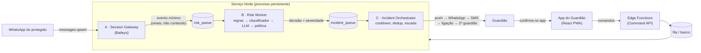

# Combinado

**Proteção familiar contra golpes de personificação por IA.**
Voz clonada e mensagens falsas de "parentes" pedindo um Pix urgente, combatidas com o que a família já faz melhor: **combinar uma senha antes** de precisar dela.

> *"Tá combinado?"* — a pergunta do dia a dia familiar brasileiro vira o nome e o mecanismo do produto.


---

## Sumário

- [O problema](#o-problema)
- [A solução](#a-solução)
- [Como funciona](#como-funciona)
- [O que o Combinado não faz](#o-que-o-combinado-não-faz-de-propósito)
- [Arquitetura](#arquitetura)
- [Stack](#stack)
- [Estrutura do repositório](#estrutura-do-repositório)
- [Como rodar localmente](#como-rodar-localmente)
- [Segurança e privacidade](#segurança-e-privacidade)
- [Status do projeto](#status-do-projeto)
- [Documentação](#documentação)

---

## O problema

Golpistas já usam IA para clonar uma voz numa ligação ou imitar a escrita de um filho no WhatsApp ("mãe, troquei de número, o app do banco travou, me faz um Pix rápido?"). O golpe de **personificação de um conhecido pedindo dinheiro** está entre os mais comuns do país e tem um agravante: o Pix é instantâneo e irreversível. Entre clonar um WhatsApp e esvaziar uma conta se passam minutos.

- ~24 milhões de brasileiros foram vítimas de golpes com Pix/boleto entre jul/2024 e jun/2025 (FBSP).
- Idosos não são o maior grupo de vítimas de fraude digital em volume, mas são o **alvo desproporcional deste golpe específico**, o de maior tíquete (média de R$ 2.200).
- 5,66 milhões de idosos brasileiros moram sozinhos (Censo 2022). O isolamento que o golpista simula já existe de fábrica.
- O mecanismo estatal de devolução (MED) recupera só ~9,3% do valor contestado. Recuperar não é prevenir.

Sob pressão, ninguém decide bem. Por isso a defesa precisa ser um **reflexo ensaiado com antecedência**, não uma verificação improvisada.

## A solução

O Combinado automatiza uma recomendação que FBI, FTC e até o banco Starling (Reino Unido) já fazem publicamente: **combinar uma palavra-código familiar antes de qualquer pedido de dinheiro**. Ele faz isso em português, no trilho do Pix/WhatsApp, e com três papéis:

| Papel | Quem é | O que faz |
|---|---|---|
| **Protegido** | O idoso (ou parente vulnerável) | **Não instala nada.** Fricção zero é pré-requisito do produto. |
| **Guardião** | O filho adulto | Configura a proteção, recebe os alertas, confirma os incidentes. É quem compra. |
| **Família** | A unidade de venda | Um plano protege vários parentes. Cobrança por círculo, não por pessoa. |

O pilar comportamental são as **Implementation Intentions** (Gollwitzer & Sheeran): o gatilho nunca é "desconfiei", é sempre *"existe um pedido de dinheiro alegando ser de um familiar"*, sem exceção. A senha é **fixa**, escolhida pela família, e ensaiada com simulações leves e periódicas.

## Como funciona



1. **Captura.** O serviço se conecta à conta de WhatsApp do protegido como um *dispositivo vinculado* (Baileys) e escuta as mensagens recebidas. Cada mensagem é reduzida a um **evento mínimo** (flags e metadados) antes de sair do Gateway.
2. **Análise de risco em camadas.** O motor decide em quatro passos, do mais barato e auditável ao mais flexível:
   1. **Regras determinísticas.** Combinações de sinais como personificação + menção a Pix + urgência, "aparelho quebrado" + dinheiro, pedido de sigilo, remetente desconhecido. Casos óbvios encerram o pipeline na hora.
   2. **Classificador estreito.** Dá um score para os casos intermediários.
   3. **LLM de apoio.** Só para os ambíguos, com saída em JSON validado, sem ferramentas, e com o texto tratado como **dado não confiável** (pode ter sido escrito por um golpista tentando manipular a análise).
   4. **Política determinística.** Código auditável que combina tudo e decide *allow / review / block* e a severidade. **A palavra final nunca é do LLM.**
3. **Incidente e escada de entrega.** Se há risco, o Orchestrator abre (ou agrupa) um incidente, aplica cooldown/deduplicação e percorre a escada até alguém confirmar: **push → WhatsApp → SMS → ligação (Twilio) → 2º guardião**, escalando sozinho se ninguém responde na janela de cada severidade. Um incidente só é "tratado" quando **uma pessoa confirma**, nunca quando uma notificação é só enviada.
4. **Confirmação e protocolo.** O guardião confirma no app (canal independente do WhatsApp possivelmente comprometido), e o protegido recebe o protocolo: *antes de qualquer Pix, peça a senha combinada*.
5. **Treino contínuo.** O app agenda **simulações** periódicas para a família ensaiar o ritual, e há um **chat de verificação** (WhatsApp e in-app) para checar uma mensagem suspeita manualmente.

O guardião recebe **o evento de risco, não a conversa**: cuidado, não vigilância. E o idoso tem um **painel próprio** para ver quem são seus guardiões e revogar acessos. Adicionar um novo guardião exige a confirmação dele.

## O que o Combinado não faz (de propósito)

A honestidade de escopo é parte do produto:

- **Não detecta voz clonada em ligação ao vivo.** Não existe hoje forma legítima de um app de terceiros escutar uma chamada em segundo plano no iOS ou no Android. O canal de voz é protegido pelo **hábito ensaiado** (a senha) mais a intervenção pós-detecção textual.
- **Não compete em detecção de deepfake biométrico** (voz/rosto). Detecção é gatilho, não promessa.
- **Não bloqueia o Pix.** Isso exigiria parceria bancária; é visão de longo prazo.
- **Não é, hoje, um fosso defensável.** O diferencial real depende de dados comportamentais brasileiros consentidos e de distribuição via instituições de confiança.
- **Usa uma biblioteca não oficial** (Baileys). Há risco real de banimento da conta se o padrão de uso for lido como automação, e por isso todo teste é feito com um chip separado, nunca com a conta pessoal do protegido.

## Arquitetura

Um **monorepo** pnpm com três decisões estruturais:

1. **Serviço Node único, três papéis lógicos.** Session Gateway, Risk Worker e Incident Orchestrator sobem no mesmo processo, mas só conversam por **filas** (PGMQ), nunca por chamada direta. Quando o volume pedir, cada papel vira um processo próprio sem reescrever nada.
2. **Supabase como contrato e barramento.** Schema Postgres, RLS por família, filas PGMQ (com *dead-letter queues*), Auth + MFA e Realtime. É a interface estável entre o app e o serviço.
3. **Command API em Edge Functions (Deno)**, por segurança e não por conveniência: elas rodam com a permissão do usuário logado e validam autorização, vínculo, cooldown e idempotência antes de publicar um job. O app **nunca escreve direto numa fila**. O serviço Node, que usa `service_role`, fica propositalmente isolado delas.

Edge Functions atuais: `setup-family`, `invite-guardian`, `accept-invite`, `revoke-guardian`, `pair-device`, `start-simulation`, `acknowledge-incident`, `check-message`, `protected-panel`.

## Stack

| Camada | Tecnologias |
|---|---|
| **App do Guardião** (`apps/web`) | React 19, Vite 7, TypeScript, Tailwind CSS v4, shadcn/ui (Radix), Vaul (drawers), TanStack Query, React Router 7, `vite-plugin-pwa` |
| **Serviço** (`apps/service`) | Node 22+, TypeScript, [Baileys](https://github.com/WhiskeySockets/Baileys) 6.17.16 (fixado), Hono, Twilio, Web Push (VAPID), Zod |
| **LLM de apoio** | NVIDIA NIM via SDK `openai` (somente sinais anonimizados, com `X-No-Training` e `X-No-Logging`); opcional, com fallback determinístico |
| **Dados e backend** | Supabase: Postgres + RLS, PGMQ, Auth (MFA/TOTP), Realtime, Edge Functions (Deno) |
| **Compartilhado** (`packages/shared`) | Tipos gerados do Supabase e contratos (comandos, eventos, incidentes), sem segredos e sem dependências de runtime |

As versões-alvo e as travas de compatibilidade estão em [`requirements.txt`](requirements.txt).

## Estrutura do repositório

```
combinado/
├── apps/
│   ├── web/                  # App do Guardião (React/Vite PWA)
│   │   └── src/{features,pages,components,hooks,lib,styles}
│   └── service/              # Serviço Node persistente
│       └── src/
│           ├── gateway/      # A · Session Gateway (Baileys, pareamento, normalização)
│           ├── risk/         # B · Risk Worker (rules, classifier, llm, policy)
│           ├── orchestrator/ # C · Incident Orchestrator (ladder, channels)
│           ├── simulation/   # simulações periódicas
│           ├── verification/ # chat de verificação via WhatsApp
│           ├── http/         # webhooks (Twilio / WhatsApp)
│           └── shared/       # config, db, fila, crypto, logging sem PII, retenção
├── packages/shared/          # tipos e contratos compartilhados
├── supabase/
│   ├── migrations/           # schema versionado (fonte da verdade)
│   └── functions/            # Command API (Edge Functions, Deno)
├── docs/                     # RIPD (LGPD) e localidade de dados
├── CLAUDE.md                 # como trabalhar no repo
├── PLANO_DE_CONSTRUCAO.md    # plano tarefa a tarefa (F0 → F13)
├── CONTEXTO_PRODUTO.md       # o porquê do produto
└── requirements.txt          # versões e travas de compatibilidade
```

O modelo de dados do MVP: `families`, `guardians`, `protected_persons`, `guardian_links`, `secrets_family`, `incidents`, `incident_deliveries`, `risk_events`, `simulations` e `audit_log`, mais o schema isolado `vault_baileys` para as chaves de sessão do WhatsApp.

## Como rodar localmente

### Pré-requisitos

- **Node.js 22.12+** (exigência do Vite 7)
- **pnpm 9+**
- Um projeto **Supabase** (a Supabase CLI roda via `npx supabase`)
- Para testar a captura de WhatsApp: **um chip/número de teste separado**. Nunca use a conta pessoal de ninguém.

### 1. Instalar

```bash
pnpm install
```

### 2. Banco e Edge Functions

```bash
npx supabase link --project-ref <seu-project-ref>
npx supabase db push                          # aplica supabase/migrations
npx supabase functions deploy <nome>          # uma por função em supabase/functions
npx supabase gen types typescript --linked > packages/shared/src/db-types.ts
```

### 3. Variáveis de ambiente

**`apps/web/.env.local`**

```env
VITE_SUPABASE_URL=
VITE_SUPABASE_ANON_KEY=   # só a anon key; o front nunca recebe a service_role
```

**`apps/service/.env`**: copie de [`apps/service/.env.example`](apps/service/.env.example). A config é validada na inicialização e o serviço não sobe sem `SUPABASE_URL` e `SUPABASE_SERVICE_ROLE_KEY`. O resto é opcional e habilita cada capacidade:

| Variável | Habilita |
|---|---|
| `NVIDIA_API_KEY` | Camada LLM de apoio do motor de risco |
| `TWILIO_*` | Ligação de intervenção e SMS |
| `VAPID_PUBLIC_KEY` / `VAPID_PRIVATE_KEY` | Web Push ao guardião |
| `VAULT_MASTER_KEY` | Criptografia de envelope das chaves do Baileys (64 hex; obrigatória em produção) |
| `WEBHOOK_PORT`, `WEBHOOK_BASE_URL`, `WHATSAPP_*` | Servidor de webhooks |

### 4. Subir

```bash
pnpm --filter @combinado/web dev        # app do guardião (Vite)
pnpm --filter @combinado/service dev    # serviço (tsx watch)
```

No primeiro uso é preciso **parear o WhatsApp**: o QR code aparece no terminal e no passo de onboarding do app. Com `VAULT_MASTER_KEY` definida, as chaves da sessão vão cifradas para o `vault_baileys`; sem ela, ficam em `apps/service/keys/` (ignorado pelo git, só para desenvolvimento).

### Testes e checagens

O serviço usa testes de fumaça (*smoke tests*), um por módulo, que rodam com o mesmo `.env` do serviço:

```bash
pnpm --filter @combinado/service test:rules      # regras determinísticas
pnpm --filter @combinado/service test:policy     # política de decisão
pnpm --filter @combinado/service test:ladder     # escada de entrega
pnpm --filter @combinado/service typecheck
pnpm --filter @combinado/web build               # tsc -b + vite build
```

A lista completa está nos `scripts` de [`apps/service/package.json`](apps/service/package.json).

## Segurança e privacidade

Princípios não negociáveis, aplicados desde o bootstrap e não "adicionados depois":

- **Sinal, não conteúdo.** Texto, áudio e telefones completos nunca vão para logs nem são persistidos além do necessário. Entre módulos trafegam flags, metadados e scores. O logger do serviço é sem PII.
- **LLM é apoio, nunca autoridade**, e nunca recebe número completo nem dados de autenticação.
- **Menor privilégio entre os papéis.** Só o Gateway toca nas chaves do Baileys; o Risk Worker não acessa chaves nem a `service_role` geral; o front só tem a `anon key`.
- **RLS em toda tabela de aplicação, por família.** Um guardião só enxerga a própria família. Ao testar, o caso negativo (o que ele *não* deveria ver) vale tanto quanto o positivo.
- **Criptografia de envelope** (AES-256-GCM) das chaves de sessão do WhatsApp.
- **MFA (TOTP) obrigatório** para o guardião, com step-up para ações sensíveis.
- **Retenção mínima.** Rotina de descarte e TTL curto para dados de terceiros.
- **Realtime é dica, não garantia.** Todo alerta depende da escada multicanal com confirmação, nunca de um único canal.
- **LGPD.** Relatório de Impacto em andamento e política de manter os dados no Brasil (`sa-east-1`). A chamada ao LLM envia apenas flags anonimizadas, o único fluxo previsto para fora do país.

Detalhes em [`docs/RIPD.md`](docs/RIPD.md) e [`docs/DATA_LOCALITY.md`](docs/DATA_LOCALITY.md). Ambos são versões iniciais do MVP e **ainda precisam de revisão jurídica** antes de qualquer lançamento público.

## Status do projeto

O projeto é construído em **14 fases** (F0 → F13), tarefa a tarefa, conforme o [`PLANO_DE_CONSTRUCAO.md`](PLANO_DE_CONSTRUCAO.md). Hoje, **78 de 84 tarefas estão concluídas**.

| Fases | Entrega | Status |
|---|---|---|
| F0–F2 | Fundações, schema/RLS/filas, Command API | ✅ |
| F3 | App do Guardião: esqueleto navegável | ✅ |
| F4–F5 | Serviço: bootstrap e Session Gateway (Baileys) | ✅ |
| F6 | Risk Worker: regras → classificador → LLM → política | ✅ |
| F7 | Incident Orchestrator: incidentes e escada | ✅ |
| F8 | App: Central de Incidentes | ✅ |
| F9 | Canais reais: WhatsApp, Twilio, Push, SMS | ✅ |
| F10 | Onboarding, simulações, chat de verificação, painel do protegido | ✅ |
| F11 | Segurança e privacidade | ✅ |
| F12 | Design e acessibilidade (dois modos emocionais, nunca só cor, PWA) | ✅ |
| **F13** | **Deploy e piloto** | ⏳ em aberto |

**Falta (F13):** deploy do app e do serviço, produção e backups do Supabase, threat model documentado, teste ponta a ponta em staging e **piloto com 2–3 famílias reais**. Esse é o marco final: dados reais de adoção do hábito, não hipóteses.

## Documentação

| Arquivo | Para quê |
|---|---|
| [`CONTEXTO_PRODUTO.md`](CONTEXTO_PRODUTO.md) | O **porquê**: mercado, modelo de negócio, concorrência, decisões de escopo |
| [`PLANO_DE_CONSTRUCAO.md`](PLANO_DE_CONSTRUCAO.md) | O **quê**: tarefas por fase e o critério de "pronto" de cada uma |
| [`CLAUDE.md`](CLAUDE.md) | O **como**: fluxo de trabalho e guardrails para o assistente de código |
| [`requirements.txt`](requirements.txt) | Versões e travas de compatibilidade |
| [`docs/RIPD.md`](docs/RIPD.md) | Relatório de Impacto à Proteção de Dados (LGPD) |
| [`docs/DATA_LOCALITY.md`](docs/DATA_LOCALITY.md) | Onde cada dado reside |

---

Projeto desenvolvido para uma competição de produto/IA de 6 semanas. Convenção de commits: `feat|fix: <o que foi feito> (T<fase>.<número>)`.
